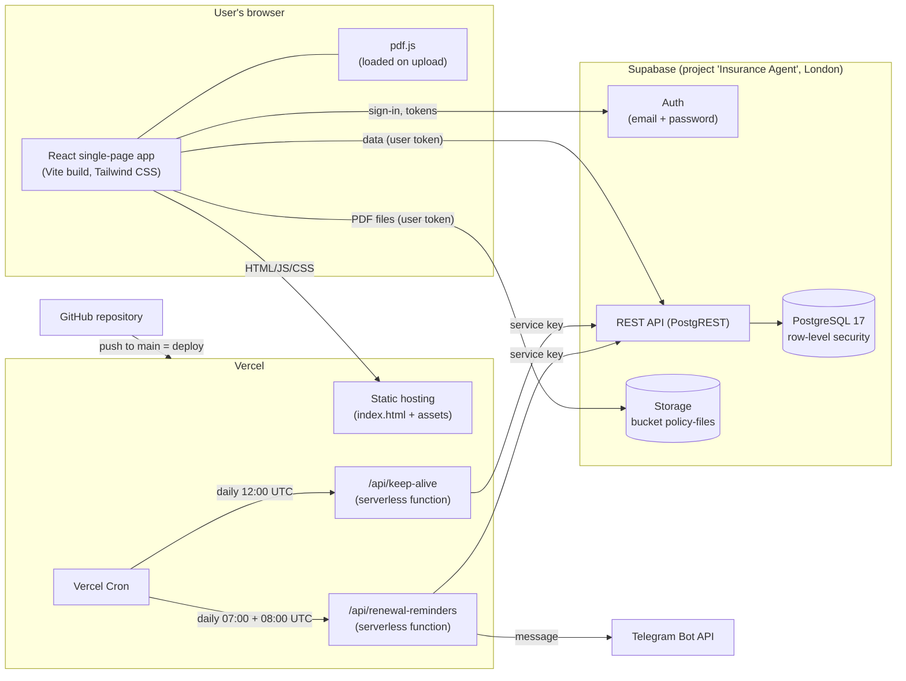
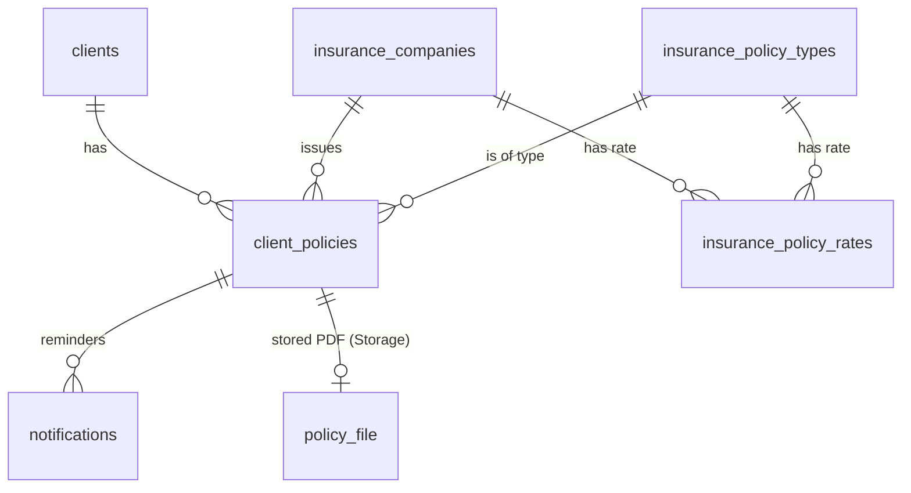

# CommissionPro — System Overview

Technical description of the insurance commission tracker: architecture, tools and external services,
business logic, data model, security, deployment, and size / used space.

| | |
|---|---|
| **Status** | In production |
| **Production URL** | https://insurance-commission.vercel.app |
| **Repository** | https://github.com/OZdolyny/insurance-commission (branch `main` = production) |
| **Measurements taken** | 27 Nov 2026 (code at commit `d91cfb9`) |

---

## Contents

1. [What the app does](#1-what-the-app-does)
2. [Architecture](#2-architecture)
3. [Technology stack](#3-technology-stack)
4. [External services](#4-external-services)
5. [Development tools](#5-development-tools)
6. [Repository structure](#6-repository-structure)
7. [Features and business logic](#7-features-and-business-logic)
8. [Data model](#8-data-model)
9. [Security model](#9-security-model)
10. [Configuration (environment variables)](#10-configuration-environment-variables)
11. [Scheduled jobs](#11-scheduled-jobs)
12. [Deployment and workflow](#12-deployment-and-workflow)
13. [Size and used space](#13-size-and-used-space)
14. [Testing](#14-testing)
15. [Database migration history](#15-database-migration-history)
16. [Known limitations and possible next steps](#16-known-limitations-and-possible-next-steps)

---

## 1. What the app does

CommissionPro is a web app for an insurance agent to track **clients, insurance policies and the
commission earned** on them.

- Keeps clients, insurance companies, policy types and the commission rate per company and policy type.
- Records policies and calculates the commission automatically.
- Tracks whether each commission is **paid or pending**.
- **Imports a policy from its PDF** (Ukrainian motor third-party liability, "Автоцивілка"): reads the client,
  dates, premium, car and insurer, and stores the PDF with the policy.
- Shows an overview, upcoming renewals, and **reports** with CSV export.
- Sends a **daily Telegram reminder** about policies that are about to end.
- Requires **sign-in**; data is visible only to accounts with an app role.

---

## 2. Architecture



**Key points**

- The app is a **static single-page app**: there is no app server. The browser talks directly to Supabase with
  the signed-in user's token, and the database's **row-level security** decides what each user may read or change.
- Only two **serverless functions** exist, both run on a schedule: keep-alive and Telegram reminders. They use the
  server-only Supabase service key.
- **PDF reading happens entirely in the browser** (pdf.js); the PDF is uploaded to Storage only if the user chooses to store it.
- Navigation uses **hash routes** (`#/policies?client=12`), so the app works on static hosting without server rewrites.

---

## 3. Technology stack

| Layer | Technology | Version | Used for |
|---|---|---|---|
| UI framework | React, React DOM | 18.3.1 | Components, state |
| Build tool | Vite (+ @vitejs/plugin-react) | 5.4.21 (4.7.0) | Dev server, production build, code splitting |
| Styling | Tailwind CSS (+ @tailwindcss/vite) | 4.3.0 | Utility classes, design tokens (`@theme`) |
| Class merging | clsx + tailwind-merge | 2.1.1 / 3.7.0 | `cn()` helper; page classes override component defaults |
| Icons | lucide-react | 1.17.0 | All icons |
| Database client | @supabase/supabase-js | 2.107.0 | Auth, REST queries, Storage (browser and server functions) |
| PDF text extraction | pdfjs-dist (legacy build) | 4.10.38 | Reading policy PDFs in the browser (lazy-loaded) |
| Font | Inter (Google Fonts) | — | Typography, aligned digits |
| Runtime (server functions) | Node.js on Vercel, Web `Request`/`Response` handlers | — | `/api/*` |
| Language | JavaScript (ES modules, JSX) | — | All code; no TypeScript |

---

## 4. External services

| Service | What is used | Where it is configured | Plan / cost |
|---|---|---|---|
| **Supabase** (project "Insurance Agent", region eu-west-2 London, PostgreSQL 17.6) | PostgreSQL database, Auth (email + password), REST API, Storage (private bucket `policy-files`), migrations | Supabase dashboard; SQL files in this repo | Free plan |
| **Vercel** | Static hosting, 2 serverless functions, 3 cron entries, automatic deploy from GitHub `main` | `vercel.json`, Vercel → Settings → Environment Variables | Hobby (free) — assumed; check the Vercel dashboard |
| **GitHub** | Source code (public repository), branches, history; deploy trigger | github.com/OZdolyny/insurance-commission | Free |
| **Telegram Bot API** | Daily renewal reminder message to one chat (`sendMessage`, HTML format) | Bot created with @BotFather; token and chat id in Vercel | Free |
| **Google Fonts** | Inter font (CSS from fonts.googleapis.com) | `index.html` | Free |

Not used: no email service, no SMS, no analytics, no payment provider, no error-tracking service.

---

## 5. Development tools

| Tool | Version | Purpose |
|---|---|---|
| Node.js / npm | 24.22 / 11.19 (developer machine) | Running scripts, installing packages |
| Vitest | 2.1.9 | Unit and component tests (`npm test`) |
| @testing-library/react + jsdom | 16.3.3 + 25.0.1 | Rendering components in tests |
| ESLint (+ react, react-hooks plugins) | 9.39.5 | Code checks (`npm run lint`) |
| Git + GitHub | — | Version control, feature branches |
| Claude Code (AI coding assistant) | — | Used to review, build and test the app, and to apply database changes through the Supabase connector |

`npm` scripts: `dev`, `build`, `preview`, `lint`, `test`, `test:watch`.

---

## 6. Repository structure

Line counts exclude tests.

```
index.html                     Page shell; applies the saved theme before first paint; loads Inter font
vercel.json                    Cron schedule for the two server functions
eslint.config.js               Lint rules
package.json                   Dependencies and scripts
database-schema.sql            Full schema for a fresh database
migration-*.sql                Step-by-step changes for an existing database (see section 15)
public/                        Icons, favicon, PWA manifest (621 KB)
docs/SYSTEM-OVERVIEW.md        This document

api/                           Vercel serverless functions (308 lines)
  keep-alive.js                 Daily database ping (keeps the free project active)
  renewal-reminders.js          Daily Telegram reminder job
  _lib/telegram.js              Minimal Telegram Bot API client (not an endpoint: "_" prefix)

src/
  main.jsx, App.jsx             Entry point; sign-in gate; app shell, header, routing        (212)
  index.css                     Design tokens: colors for light/dark themes, base styles       (231)
  pages/                        One file per page                                             (2,976)
    Dashboard.jsx                Overview: totals by period, upcoming renewals
    Clients.jsx                  Clients: search, sort, add/edit, policy count
    Policies.jsx                 Policies: grid, filters, add/edit form, files
    Commissions.jsx              Commissions: paid/pending, bulk "mark paid", CSV
    Reports.jsx                  Reports: filters, totals, CSV
    Companies.jsx, PolicyTypes.jsx, PolicyRates.jsx   Reference data
  components/                   Larger building blocks                                        (1,446)
    Sidebar.jsx                  Navigation, Upload PDF, signed-in user, sign out
    AuthScreens.jsx              Login, forgot password, choose password, no access
    PolicyImport.jsx, PolicyImportDialog.jsx   PDF import and review dialog
    PolicyFileField.jsx, PolicyFileViewer.jsx  Attach / preview / download policy files
    PeriodFilter.jsx, ThemeToggle.jsx
    ui/                          Design-system components: Button, Card, Input, Select,
                                 Textarea, Table, Badge, Dialog, ConfirmDialog, Toast,
                                 SearchInput, Label                                           (471)
  hooks/                        usePeriodFilter, useTableControls (search + sort)             (99)
  lib/                          Logic without UI                                              (1,412)
    supabase.js, auth.jsx        Supabase client; sign-in state and roles
    commission.js, policyForm.js Commission math; policy validation
    reports.js, csv.js           Report rows, totals, CSV export
    renewals.js                  Reminder schedule, renewal detection, Telegram text
    policyFiles.js               Storage upload / replace / delete / preview
    router.js, theme.js, utils.js, errors.js
    policyPdf/                   unwrap.js, extractText.js, parsePolicy.js, matching.js, normalize.js
```

---

## 7. Features and business logic

### 7.1 Pages

| Page | Main functions |
|---|---|
| **Overview** | Clients, policies and commission totals (all time / year / month); **Upcoming Renewals** (ending in 30 days or ended in the last 14) with Renewed / Won't renew buttons |
| **Clients** | Search, sort, add, edit; policy count links to that client's policies |
| **Policies** | Grid with search, sort, expiry filters (30/60/90 days, expired); add/edit form; renewal status; policy file (attach, replace, delete, preview, download); pinned row actions |
| **Commissions** | Paid / pending totals and filters, period filter, bulk "mark as paid" with payment date, CSV export |
| **Reports** | Full name, policy number, policy date, amount, commission, company, type; filters: period, commission status, company, type, exclude zero commission; totals; CSV export |
| **Companies / Policy Types / Rates** | Reference data with add, edit, delete; rates entered as percentages |
| **Upload PDF** (sidebar, every page) | Import a policy from its PDF (section 7.4) |

### 7.2 Commission calculation

```
discount   = policy amount − paid amount          (stored as a generated column)
commission = max(0, policy amount × rate − discount), rounded to cents
commission = 0 when "No commission" is ticked
```

- Rates are stored as decimals (0.15) and shown/entered as percentages (15%).
- A policy keeps the rate it was saved with. Editing keeps that rate unless the company/type changes or the user
  chooses "Use current rate".
- Validation: paid amount ≤ policy amount; dates are real calendar dates (`dd/mm/yyyy`); end date ≥ start date.
- Dates are handled as local calendar dates (no UTC day shifts).

### 7.3 Payment status and reports

- New policies start as **pending**; "Mark paid" sets **paid** with a payment date; editing a policy never resets it.
- **Policy date** = contract date ("Дата укладення Договору"). Report period filters use the policy date, and
  fall back to the start date for older policies without one.
- CSV exports contain exactly the rows shown, with a UTF-8 BOM so Excel opens Cyrillic correctly.

### 7.4 PDF policy import

```
file ─► unwrap signature envelope ─► pdf.js text ─► group into rows ─► parse layout ─► match ─► review dialog ─► save (+ store PDF)
```

1. **Unwrap**: insurers send PDFs wrapped in a qualified electronic signature (PKCS#7 / CMS, still named `.pdf`).
   A small DER reader extracts the inner PDF (also handles chunked content); plain PDFs pass through.
   The signature is **not verified**.
2. **Text extraction**: pdf.js (legacy build, lazy-loaded) returns text items; items on the same line are joined
   into rows, with `|` between table cells.
3. **Parsing** (`parsePolicy.js`): all insurers fill in the official MTSBU form (sections 1–18); three layouts are supported:

   | Layout | Differences handled |
   |---|---|
   | BBS Insurance (current) | Labelled rows; `EP-…` numbers |
   | BBS Insurance (older) | "П.І.Б." and "E-mail" labels |
   | Arsenal Insurance | Policyholder without labels; digits-only number; premium without "грн"; electronic stamp text printed over the car table (values taken from the rightmost cell); brand repeated in the model |

   Extracted: policy number, client (name in normal capitalisation, phone `(0XX) XXX XX XX`, email), policy/start/end
   dates, premium, insurer and its ЄДРПОУ code, car (brand, model, plate, year, VIN). Cyrillic look-alike letters in
   plates and models are converted to Latin.
4. **Matching**: client by first + last name (either order; a different father name means a different person) or
   last name + phone; company by transliterated insurer name ("ББС ІНШУРАНС" → BBS); policy type "Цивілка" for motor
   liability; **duplicate policy numbers are blocked**.
5. **Review dialog**: everything is editable; existing client shown with Edit, new client with Add client; client
   comment editable; car brand, model and plate form the policy comment; commission preview.
6. **Save**: the policy is inserted, then (option on by default) the original PDF is stored (section 7.5).

### 7.5 Policy files

- One PDF per policy, in the **private** Storage bucket `policy-files` (PDF only, 10 MB limit).
- Path `"<policy id>/<random uuid>.pdf"`; the original file name is kept in `file_name` for downloads.
- The original file is stored **unchanged** (keeps the insurer's signature); the preview unwraps it.
- Files are checked by content (PDF or signed PDF), not just the name.
- **Order of operations** prevents broken links and orphaned files: upload → point the policy at the file → remove the
  old file; if the policy update fails, the new upload is removed. Deleting a policy deletes its file.

### 7.6 Renewals and Telegram reminders

- **Renewal status** on a policy (Edit form or Overview buttons): *Not decided yet* (default), *Renewed*, *Won't renew*.
  Any status stops reminders and removes the policy from Upcoming Renewals.
- **Automatic renewal detection**: a newer policy for the same client and policy type that starts no earlier than
  30 days before the old one ends (same plate if both comments contain one) also stops the reminders.
- **Reminder points**: 30, 7, 1 and 0 days before the end date, and "ended, not renewed" (up to 3 days after).
  Each point is sent once; a policy added late gets only the nearest point.
- One summary message a day at **10:00 Kyiv time**, grouped by urgency, with client, phone, policy, car and an
  "Open" link. Failed sends are retried on later runs (up to 5 attempts); Telegram rate limits are respected.
- The `notifications` table records each reminder (unique per policy + reminder point + channel), so a second run
  never sends duplicates. Manual checks: `?dry=1` (show the message without sending) and `?test=1` (test message).

### 7.7 Sign-in, roles and access

- Supabase Auth, email + password. Screens: sign in, forgot password (reset email), choose password (after an
  invitation or reset link), no access, sign out. Public sign-up is turned off.
- **Roles** in `app_users`: `super_admin`, `admin`, `member`. Currently one account (`super_admin`).
  An account without a role sees "No access" and no data.
- Details in section 9.

### 7.8 Keep-alive

Supabase pauses free projects after a week without activity. `/api/keep-alive` runs daily and makes one small
read with the service key.

### 7.9 Interface

- Design tokens in `src/index.css` for a **light and a dark theme** (indigo brand, slate neutrals, navy sidebar);
  text meets WCAG AA contrast, field borders 3:1.
- Theme switch Light / Dark / System in the header, remembered per browser, applied before first paint.
- Responsive: slide-out sidebar on phones; tables scroll sideways with the actions column pinned.
- Accessibility: keyboard focus rings, "Skip to content" link, native selects, reduced motion respected.
- Toast messages and a confirm dialog for destructive actions.

---

## 8. Data model

PostgreSQL schema `public` (as in the live database). Primary keys in **bold**.

| Table | Columns | Notes |
|---|---|---|
| `clients` | **id** int, first_name, last_name, father_name, phone_number, email, comment, created_at | |
| `insurance_companies` | **code** varchar(3), name, address, manager_name, manager_email, manager_phone, created_at | e.g. BBS, ARS |
| `insurance_policy_types` | **type** varchar(3), name, created_at | e.g. CPV = Цивілка |
| `insurance_policy_rates` | **id** int, insurance_company_code → companies, insurance_policy_type → types, commission_rate numeric, created_at | One rate per company + type |
| `client_policies` | **id** int, client_id → clients, insurance_company_code, insurance_policy_type, policy_number, amount, paid_amount, discount (generated), commission_rate, commission_amount, no_commission, payment_status (pending/paid), payment_date, policy_date, start_date, end_date, comment, renewal_status, reminders_snoozed_until, file_path, file_name, file_size, file_uploaded_at, created_at | Central table |
| `notifications` | **id** bigint, policy_id → policies, kind, days_before, channel, status, attempts, last_error, sent_at, created_at | Reminder log; unique (policy, kind, days_before, channel) |
| `app_users` | **user_id** uuid → auth.users, role (super_admin/admin/member), created_at | Who may use the app |



Database functions: `app_role()` and `is_app_user()` (security definer, used by the access rules).
Extensions enabled by Supabase: pg_graphql, pg_stat_statements, pgcrypto, plpgsql, supabase_vault, uuid-ossp.

---

## 9. Security model

| Who | Data tables | Policy files (Storage) | Role table | Reminder log |
|---|---|---|---|---|
| Anonymous visitor (public key) | **No access** ("permission denied") | **No access** (bucket private) | No access | No access |
| Signed in, no role | Sees **no rows** | No access | Own row only (none) | No access |
| App user (any role) | Full read/write | Read, add, replace, delete | Own row | No access |
| Super admin | Full read/write | Read, add, replace, delete | All rows; can manage roles | No access |
| Server functions (service key) | Full (bypasses rules) | — | — | Full |

- **Row-level security** on every table; access rules check `is_app_user()`, not just "signed in".
- Anonymous privileges revoked on all tables and on the helper functions; new tables are hidden from anonymous
  visitors by default.
- Secrets (service key, Telegram token, cron secret) exist only in Vercel's server settings, never in `VITE_`
  variables (those are built into the browser code). The public key in the browser is safe by design.
- Cron endpoints require `CRON_SECRET`. Error logs contain no client data.
- Personal data in the repository: none (tests use made-up data; no emails or passwords are committed).

---

## 10. Configuration (environment variables)

Names only; values live in Vercel → Settings → Environment Variables (Production) and in a local `.env` for development.

| Variable | Used by | Secret | Purpose |
|---|---|---|---|
| `VITE_SUPABASE_URL` | Browser, server functions | No | Supabase project address |
| `VITE_SUPABASE_ANON_KEY` | Browser | No (public by design) | Public key; access controlled by row-level security |
| `SUPABASE_SERVICE_ROLE_KEY` | Server functions | **Yes** | Full database access for keep-alive and reminders |
| `CRON_SECRET` | Server functions | **Yes** | Only Vercel Cron may call `/api/*` |
| `TELEGRAM_BOT_TOKEN` | Reminders | **Yes** | Bot that sends reminders |
| `TELEGRAM_CHAT_ID` | Reminders | No | The chat that receives reminders |
| `APP_URL` | Reminders | No | Adds "Open" links to the message (optional) |
| `TELEGRAM_DRY_RUN` | Reminders | No | Log the message instead of sending (optional) |

Supabase dashboard settings: public sign-up **off**; Site URL = production address (for invitation and reset links).

---

## 11. Scheduled jobs

From `vercel.json` (times in UTC):

| Endpoint | Schedule | What it does |
|---|---|---|
| `/api/keep-alive` | daily 12:00 | One small read so the free Supabase project is not paused |
| `/api/renewal-reminders` | daily 07:00 and 08:00 | Runs twice so that one run falls at **10:00 Kyiv** in both winter (UTC+2) and summer (UTC+3); the other run skips itself |

Vercel's free plan runs crons once a day per entry, at an approximate time within the scheduled hour.

---

## 12. Deployment and workflow

- **Branches**: each change is made on a feature branch (`feature/…`, `fix/…`, `docs/…`), checked
  (lint, tests, build), then merged into `main`.
- **Deploy**: every push to `main` deploys to production on Vercel automatically; other branches get preview
  deployments (the Preview environment uses different Supabase settings, so data may not load there).
- **Database changes** are written as SQL files in the repository and applied to Supabase **before** the app version
  that needs them, in an order that never cuts the live app off from its data.
- **Local development**:
  ```bash
  npm install
  cp .env.example .env    # then fill in VITE_SUPABASE_URL and VITE_SUPABASE_ANON_KEY
  npm run dev             # http://localhost:5173
  npm test && npm run lint && npm run build
  ```

---

## 13. Size and used space

### 13.1 Code

| Area | Files | Lines |
|---|---|---|
| Pages (`src/pages`) | 8 | 2,976 |
| Components (`src/components`, incl. `ui/`) | 20 | 1,917 |
| Logic (`src/lib`, incl. `policyPdf/`) | 17 | 1,412 |
| Hooks (`src/hooks`) | 2 | 99 |
| Entry + styles (`main.jsx`, `App.jsx`, `index.css`) | 3 | 443 |
| Server functions (`api`) | 3 | 308 |
| **Application code total** | **53** | **≈ 7,155** |
| Tests | 16 | 1,673 |
| SQL (schema + 8 migrations) | 9 | — |

Repository: 99 tracked files, 42 commits since 29 Jan 2026, about **95 KB** of compressed Git history.

### 13.2 Production build (`npm run build`)

| File | Size | Compressed (gzip) | Loaded |
|---|---|---|---|
| App JavaScript (`index-*.js`) | 546 KB | **150 KB** | On every visit |
| Styles (`index-*.css`) | 44 KB | **8 KB** | On every visit |
| pdf.js (`pdf-*.js`) | 409 KB | 123 KB | Only when a PDF is uploaded |
| pdf.js worker (`pdf.worker.min-*.mjs`) | 1.42 MB | — | Only when a PDF is uploaded |
| `index.html` | 2 KB | 1 KB | On every visit |
| Icons and manifest (`public/`) | 621 KB | — | As needed |
| **Total `dist/` folder** | **3.0 MB** (14 files) | | |

A normal visit downloads about **160 KB** compressed (plus the Inter font).
Installed packages (`node_modules`): 373, including dependencies of dependencies. The app itself declares
9 runtime dependencies (section 3) and 13 development tools (section 5).

### 13.3 Database and storage (live, 27 Nov 2026)

| Item | Value |
|---|---|
| Database size (incl. PostgreSQL system data) | **13 MB** |
| App tables (data + indexes) | **≈ 392 KB** — client_policies 128 KB, insurance_policy_rates 72 KB, notifications 64 KB, others 32 KB each |
| Clients | 30 |
| Policies | 34 (30 with a policy date, 11 with a stored PDF) |
| Insurance companies / policy types / rates | 4 / 7 / 5 |
| Reminder log entries | 0 (no policy has reached a reminder point since the feature went live) |
| Accounts / app roles | 1 / 1 (`super_admin`) |
| Storage bucket `policy-files` | **11 files, 1.83 MB** (average ≈ 175 KB per policy PDF) |

### 13.4 Headroom on the free plans

| Resource | Used | Supabase Free plan limit | Used |
|---|---|---|---|
| Database | 13 MB | 500 MB | ≈ 2.6% |
| File storage | 1.83 MB | 1 GB | ≈ 0.2% (room for ≈ 5,500 more policy PDFs) |

Plan limits change over time; check the current Supabase and Vercel pricing pages before relying on them.
At the current pace (tens of policies), neither limit is a concern for years.

---

## 14. Testing

`npm test` runs **141 tests in 16 files** (Vitest); all pass.

| Area | What is tested |
|---|---|
| Commission and forms | Calculation, rounding, rate conversion, policy validation, payment status on edit |
| Dates and utilities | Parsing/masking `dd/mm/yyyy`, local dates, periods, days until, phone format, class merging |
| PDF import | Signature unwrapping (incl. chunked), row grouping, all three layouts, client/company/type matching, duplicates, brand/model split |
| Import dialog (rendered) | Existing/new client, editing client and comment, car comment, duplicate block, storing the PDF, non-policy files |
| Policy files | Validation by content, upload/replace/delete order, cleanup on failure, the form field |
| Reports | Rows, filters (period, status, company, type, zero commission), totals, CSV |
| Sign-in (rendered app) | Login, wrong password, password reset, invitation + choose password, no access, sign out |
| Server functions | Keep-alive key choice and errors; reminder planning, Kyiv time, delivery hour, Telegram retries |
| Routing, CSV, errors | Hash routes, CSV escaping, friendly error messages |

Tests use made-up data only; the real policy PDFs were checked locally and never committed.

---

## 15. Database migration history

Applied to the live Supabase project (in order):

| Date | Migration | File |
|---|---|---|
| 9 Nov 2026 | `add_policy_date` | `migration-add-policy-date.sql` |
| 9 Nov 2026 | `add_renewal_reminders` | `migration-add-renewal-reminders.sql` |
| 13 Nov 2026 | `auth_app_roles` | `migration-auth-1-roles.sql` |
| 13 Nov 2026 | `auth_lock_data_tables` | `migration-auth-2-lock-tables.sql` |
| 13 Nov 2026 | `auth_hardening_functions_and_internal_tables` | `migration-auth-3-hardening.sql` |
| 13 Nov 2026 | `auth_hide_data_tables` | `migration-auth-4-hide-data-tables.sql` |
| 13 Nov 2026 | `policy_files_storage` | `migration-policy-files.sql` |

Earlier changes (before migrations were recorded): the original schema and `migration-update-commission.sql`
(paid amount, no-commission flag, policy comment). `database-schema.sql` contains the complete current schema for
a fresh install.

---

## 16. Known limitations and possible next steps

- **PDF import** supports BBS Insurance (two forms) and Arsenal Insurance; other insurers use the same official form
  but may need small parser adjustments. The electronic signature is not verified.
- **Reminder snooze**: the database has `reminders_snoozed_until`, but nothing in the app sets it yet
  (intended for a Telegram "Snooze" button).
- **Telegram buttons** (Renewed / Snooze from the message) are not implemented; status is set in the app.
- **Leaked-password protection** in Supabase Auth is off (dashboard setting; may need a paid plan).
- **One file per policy**; extra documents (amendments, receipts) would need a separate files table.
- **Client reminders** (SMS/Viber to clients) are not implemented.
- The Preview environment on Vercel points to different Supabase settings, so preview deployments may not show data.
